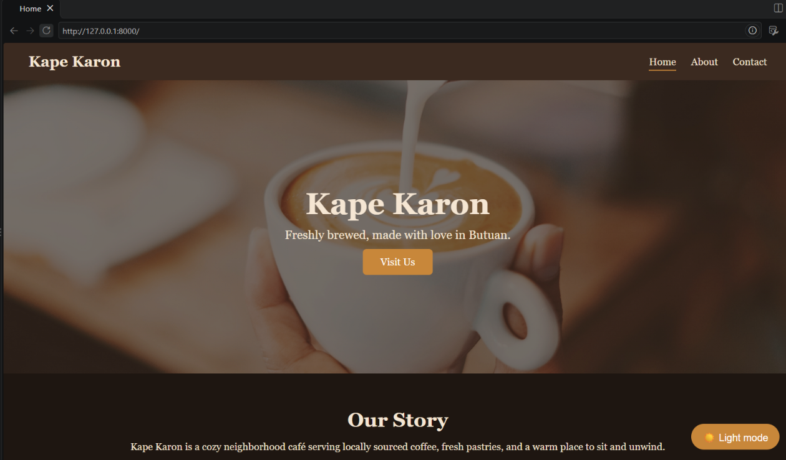
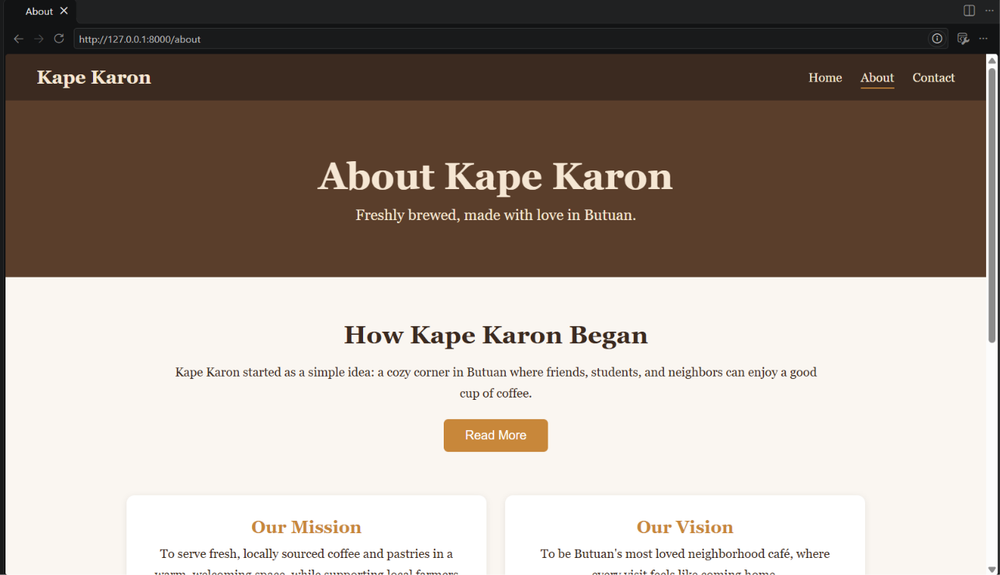
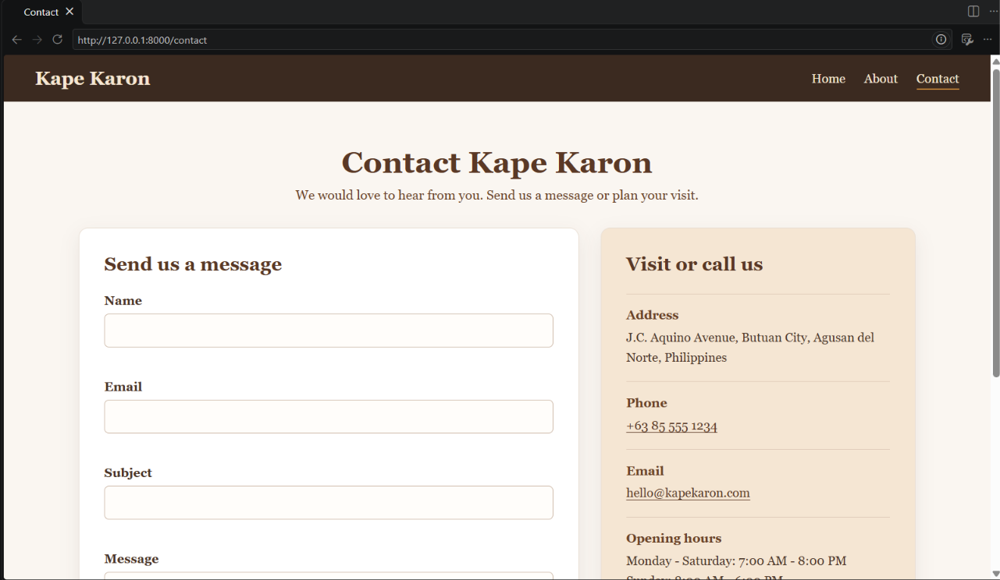

# Kape Karon Café – Multi-Page Laravel Web App

**Group Name:** Lara-Proj-AIBJ2-Tautjo-Sato-Setarios
**Section:** AIBJ2

## Members
- Jundy Tautjo (Group Leader)
- Mirai Sato
- Gio Setarios

## Theme
A local café and coffee shop website, **Kape Karon**, serving freshly brewed coffee and local pastries in Butuan.

## Modules and Branches

| Member | Module | Branch |
|---|---|---|
| Jundy Tautjo | Project setup, master layout, Home page (hero section, Our Story cards, dark/light mode toggle) | `dev-member1-Tautjo` |
| Mirai Sato | About page | `dev-member2-Sato` |
| Gio Setarios | Contact page | `dev-member3-Setarios` |

## Screenshots

### Home Page


### About Page


### Contact Page


## How to Run the Project

1. Clone the repository:
   ```bash
   git clone https://github.com/jundygarcia/Lara-Proj-AIBJ2-Tautjo-Sato-Setarios.git
   ```
2. Go into the project folder:
   ```bash
   cd Lara-Proj-AIBJ2-Tautjo-Sato-Setarios
   ```
3. Install dependencies:
   ```bash
   composer install
   ```
4. Create the environment file and generate the app key:
   ```bash
   cp .env.example .env
   php artisan key:generate
   ```
5. Run the migrations (answer "yes" if asked to create the database):
   ```bash
   php artisan migrate
   ```
6. Start the server:
   ```bash
   php artisan serve
   ```
7. Open `http://127.0.0.1:8000` in your browser.